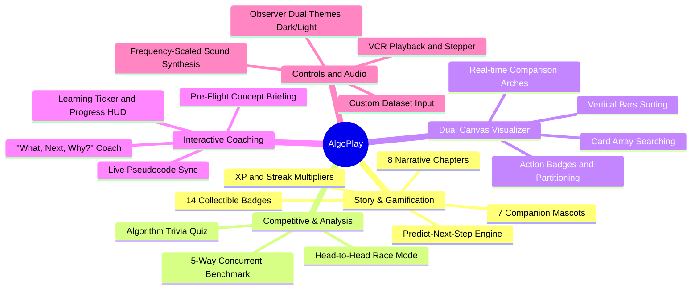

# AlgoPlay — Complete Features & Product Specification

**Author & Creator:** Aditi Phulre  
**License:** MIT License  
**GitHub Repository:** [github.com/phulreaditi/AlgoPlay](https://github.com/phulreaditi/AlgoPlay)  
**Live Application:** [phulreaditi.github.io/AlgoPlay](https://phulreaditi.github.io/AlgoPlay/)  

---

## 1. Executive Summary

**AlgoPlay** is an interactive algorithm visualizer and gamified learning engine designed to transform computer science education. It bridges theoretical algorithm complexity with sensory intuition through synchronized real-time animations, companion mascots, branching step predictions, head-to-head racing, and an 8-chapter narrative campaign.

The project is engineered as a **dual-platform system**:
1. **Desktop Native (Python + Tkinter)**: A zero-dependency offline application using Python standard library primitives.
2. **Web Native (HTML5 Canvas + Modern ES6)**: A responsive browser application deployed globally via GitHub Pages.

---

## 2. Comprehensive Feature Inventory



---

### 2.1 Narrative Story Campaign & Levels
* **8 Story Chapters**: A curriculum covering algorithm fundamentals from elementary sorting to logarithmic searching and divide-and-conquer strategies.
* **Mascot Dialogue & Canvas Speech Bubbles**: Narrative bubbles rendered directly on the canvas featuring dynamic character expressions and situational dialogue based on algorithm state.
* **Branching Decisions & Level Progression**: Levels unlock sequentially upon achieving mastery; progress persists locally to `saves/progress.json`.
* **Boss Levels**: Climax challenge levels at the conclusion of key chapters testing predictive accuracy under varying edge-case datasets (reversed arrays, near-sorted data, duplicate values).

---

### 2.2 Companion Mascots

| Mascot | Associated Algorithm | Personality & Voice |
| :--- | :--- | :--- |
| 🐻 **Bubble Bear** | Bubble Sort | Methodical, patient, checks every neighbor step-by-step. |
| 🦡 **Insert Badger** | Insertion Sort | Tidy and neat; sorts like arranging a hand of playing cards. |
| 🦥 **Select Sloth** | Selection Sort | Deliberate and observant; scans entire remaining span for the absolute minimum. |
| 🦉 **Merge Owl** | Merge Sort | Strategic and intellectual; divide-and-conquer master of recursion. |
| 🦊 **Quick Fox** | Quick Sort | Energetic and agile; partitions datasets dynamically around a pivot. |
| 🐕 **Linear Hound** | Linear Search | Loyal and relentless; tracks items element-by-element without assumptions. |
| 🦅 **Binary Falcon** | Binary Search | Sharp-sighted apex hunter; halves the search territory with every dive. |

---

### 2.3 Gamification & Prediction Engine
* **Predict-Next-Step Engine (`HintEngine` & `PredictPanel`)**:
  * Triggers interactive checkpoints during algorithm runs, automatically pausing execution.
  * Prompts learners with multi-choice forecasting questions: *"Will elements at index 3 and 4 swap?"*, *"Where will the binary probe land next?"*, or *"Which element becomes the new pivot?"*
  * Displays instant green/red visual validation with algorithmic reasoning.
* **XP Points & Streak Multipliers**:
  * Awards base XP for correct step predictions, quiz answers, and chapter completions.
  * Multiplier bonuses activate on consecutive correct streaks, boosting overall score.
  * Real-time XP status badge (`⚡ XP`) in the top navigation header.
* **14 Collectible Achievement Badges**:
  * Badges unlock automatically based on performance milestones (e.g., *First Spark*, *Streak Master*, *Sort Sensei*, *Binary Sniper*, *Speed Demon*).
  * Evaluated through `badges.py` and saved permanently in `saves/progress.json`.

---

### 2.4 Competitive & Benchmark Modes
* **Head-to-Head Race Mode (`🏁 Race`)**:
  * Split-canvas dual window pitting any two sorting algorithms against one another on the identical dataset.
  * Real-time tracking of comparison counts, swap counts, and completion percentage.
  * Floating particle confetti animation celebrates the winning algorithm.
* **Comparative Benchmarking (`📊 Benchmark`)**:
  * Executes all five sorting algorithms simultaneously in the background on the active array.
  * Visualizes an instant comparative bar chart breaking down total comparisons versus memory writes/swaps.
* **Algorithm Trivia Quiz (`🎮 Quiz`)**:
  * Interactive challenge window containing questions covering time complexities ($O$, $\Omega$, $\Theta$), memory bounds, invariants, and edge-case behavior.
  * Includes auditory feedback beeps for correct and incorrect answers.

---

### 2.5 Dual-Canvas Visualization Engine

#### Sorting Canvas (Vertical Proportional Bars)
* Dynamic proportional scaling adapting to window resizing.
* **Comparison Arches**: Bezier arches connecting active comparison targets with live relational text (`v1 > v2`).
* **In-Bar Action Badges**:
  * `CMP`: Active comparison probe
  * `⇄`: Memory swap or shift
  * `P`: Partition pivot line
* **State Color Highlights**:
  * Unsorted / Default: Vibrant Cobalt Blue (`#2563EB`)
  * Comparing: Amber Gold (`#F59E0B`)
  * Swapping: Rose Red (`#F43F5E`)
  * Sorted / Locked: Emerald Green (`#10B981`)
  * Pivot: Cyan (`#06B6D4`)

#### Searching Canvas (Array Inspection Cards)
* Card-based elements displaying both value and index coordinates.
* **Range Boundary Brackets (`[low … high]`)**: Visually delineates the active search window as it narrows.
* **Active Probe Indicators**: Highlights current inspection index with probe badges.
* **Elimination Strikethroughs**: Diagonal cross-out lines drawn over candidates eliminated from the search domain.
* **Match Pulse**: Celebration ring animations expand outward when the target value is discovered.

---

### 2.6 Synchronized Pseudocode & Step Coach
* **Live Pseudocode Sync**:
  * Clean, standardized pseudocode displayed beside the visualization canvas.
  * Active line highlighter tracks generator yields in exact lockstep.
* **Interactive Coach (`FunCoachPanel`)**:
  * **What happened**: Concrete explanation of the step just executed.
  * **What to watch next**: Predictive guidance on impending comparisons.
  * **Why? (Invariant Breakdown)**: In-depth mathematical explanation of the algorithmic invariant guaranteed at this step.
* **Pre-Flight Concept & Complexity Briefing**:
  * Interactive briefing modal accessible before launching any algorithm.
  * Provides core intuition, real-world analogies, and asymptotic bounds:
    - Best Case ($\Omega$)
    - Average Case ($\Theta$)
    - Worst Case ($O$)
    - Auxiliary Space Complexity

---

### 2.7 Controls & Customization
* **VCR Playback Suite**:
  * **Start / Run**: Automated continuous execution.
  * **Step Forward**: Single-step progression for detailed study.
  * **Pause / Resume**: Freezes execution state at any millisecond.
  * **Reset**: Restores data array to its initial configuration.
  * **Shuffle**: Generates a new pseudorandom dataset.
* **Sliders & Custom Data**:
  * **Speed Slider**: Real-time animation delay adjustment from 5ms to 1000ms.
  * **Array Size Slider**: Dataset scaling from 5 elements up to 60+ elements.
  * **Custom Array Input**: Comma-separated entry field to test custom distributions (reversed, sorted, duplicates, negatives).
* **Keyboard Shortcuts**:
  * <kbd>Space</kbd> / <kbd>→</kbd> : Step forward
  * <kbd>Enter</kbd> : Start continuous animation
  * <kbd>P</kbd> : Pause / Resume
  * <kbd>R</kbd> : Reset to initial state
  * <kbd>S</kbd> : Shuffle / Randomize
* **Audio Synthesizer**:
  * Synthesizes pitch-modulated sound frequencies proportional to element heights and values, providing auditory confirmation of sorting progress.
* **Dual Modern Themes**:
  * Dark Theme (high-contrast midnight surface) and Light Theme (clean paper-white).
  * Built using an Observer Pattern (`ThemeManager`) updating all widgets instantly without app restart.

---

## 3. Algorithm Specifications & Complexity Matrix

| Algorithm | Type | Best ($\Omega$) | Average ($\Theta$) | Worst ($O$) | Space | Stable | Invariant Maintained |
| :--- | :--- | :---: | :---: | :---: | :---: | :---: | :--- |
| **Bubble Sort** | Sort | $n$ | $n^2$ | $n^2$ | $1$ | Yes | After pass $k$, the last $k$ elements are in their final sorted positions. |
| **Insertion Sort** | Sort | $n$ | $n^2$ | $n^2$ | $1$ | Yes | Prefix $A[0 \dots i-1]$ is sorted at the start of iteration $i$. |
| **Selection Sort** | Sort | $n^2$ | $n^2$ | $n^2$ | $1$ | No | Prefix $A[0 \dots i-1]$ contains the $i$ smallest elements in sorted order. |
| **Merge Sort** | Sort | $n \log n$ | $n \log n$ | $n \log n$ | $n$ | Yes | Subarrays are recursively sorted and merged preserving relative stability. |
| **Quick Sort** | Sort | $n \log n$ | $n \log n$ | $n^2$ | $\log n$ | No | Elements left of pivot are $\le$ pivot; elements right are $\ge$ pivot. |
| **Linear Search** | Search | $1$ | $n$ | $n$ | $1$ | N/A | Target does not exist in the examined prefix $A[0 \dots i-1]$. |
| **Binary Search** | Search | $1$ | $\log n$ | $\log n$ | $1$ | N/A | Target is strictly bounded within interval $A[\text{low} \dots \text{high}]$. |
| **Jump Search** | Search | $1$ | $\sqrt{n}$ | $\sqrt{n}$ | $1$ | N/A | Target is located between blocks $m \cdot k$ and $m \cdot (k+1)$. |
| **Interpolation** | Search | $1$ | $\log \log n$ | $n$ | $1$ | N/A | Assumes uniform distribution; probes estimated slope location. |
| **Exponential** | Search | $1$ | $\log n$ | $\log n$ | $1$ | N/A | Doubles bound exponent until target is bracketed, then binary searches. |
| **Ternary Search** | Search | $1$ | $\log_3 n$ | $\log_3 n$ | $1$ | N/A | Divides search space into three equal segments via two midpoints. |

---

## 4. System Architecture

```
AlgoPlay/
├── main.py              # Application shell, tab coordinator, and event loop
├── __main__.py          # Module execution entry point
├── run.bat              # Windows one-click launcher
├── run.sh               # macOS / Linux launcher
├── pyproject.toml       # Python package configuration
├── visualizer.py        # Dual canvas rendering engine (bars, cards, arches, confetti)
├── algorithm_base.py    # AlgorithmBase abstract class and AlgorithmStep dataclass
├── sorting.py           # Bubble, Insertion, Selection, Merge, Quick Sort generators
├── searching.py         # Linear, Binary, Jump, Interpolation, Exponential, Ternary Search
├── concept_briefing.py  # Pre-flight algorithm concept & complexity modal
├── concept_data.py      # Pedagogical explanations & asymptotic complexity data
├── coach.py             # Step-by-step explainer & "Why?" invariant guide
├── controls.py          # Controls, sliders, custom array entry, and complexity cards
├── hint_engine.py       # Predict-next-step interactive quiz modal
├── progress_hud.py      # Completion percentage HUD & learning tip ticker
├── race_window.py       # Head-to-head algorithm race window
├── quiz.py              # Gamified algorithm trivia window
├── story_tab.py         # Story Mode tab controller
├── story.py             # Narrative chapters, level data, and boss challenges
├── mascots.py           # 7 algorithm companion mascots
├── badges.py            # Achievement badges and unlock logic
├── stats.py             # Performance metric counters (comparisons, swaps, accesses)
├── theme.py             # Dark & light theme color palettes and observer manager
├── widgets.py           # Custom Tkinter widget helpers (FlatButton, Card, etc.)
├── web/                 # Web visualizer application (HTML5 Canvas + ES6)
├── saves/               # Persistent progress and XP storage (progress.json)
└── tests/               # Unit and GUI test suite (test_algorithms.py, test_gui.py)
```

---

## 5. Execution & Deployment Reference

### Desktop Application (Tkinter)
- **Windows**: Double-click `run.bat` or run:
  ```bash
  python main.py
  ```
- **macOS & Linux**:
  ```bash
  chmod +x run.sh && ./run.sh
  ```
- **Run as Python Module**:
  ```bash
  python -m AlgoPlay
  ```
- **Run Automated Test Suite**:
  ```bash
  python -m unittest discover tests
  ```

### Live Web Application (GitHub Pages)
- **Live URL**: [https://phulreaditi.github.io/AlgoPlay/](https://phulreaditi.github.io/AlgoPlay/)
- **Hosting**: Deployed directly from the `gh-pages` branch via GitHub Pages with automated CI/CD synchronization.
